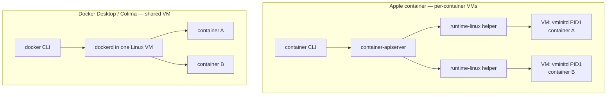
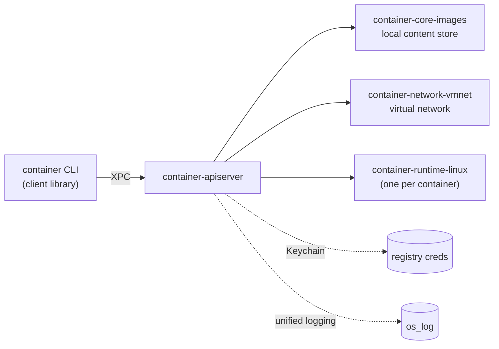
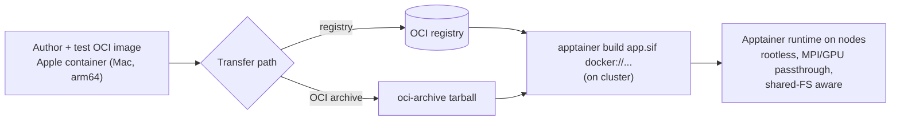

# Apple `container` — Deep Dive Reference

> **Version & accuracy note:** Pinned to `container` **1.0.0** (released 2026-06-09). Apple publishes documentation *per release tag*; the `main`-branch docs explicitly warn they describe the current branch rather than a fixed release. The `container machine` feature and a few flags described here come from the current docs and may post-date the exact 1.0.0 tag — **verify with `container <subcommand> --help`** before relying on syntax. Where the source request and the live docs disagreed (notably some `container machine` flag spellings), this reference follows the live Apple docs and flags the difference inline. This builds on the [[apple-container-beginner-guide|Apple container Beginner's Guide]].

## Overview

This reference covers Apple `container` from architecture to cluster-adjacent workflows. It assumes you are fluent with the CLI, comfortable with Docker concepts, and have done real container or HPC work. It explains *why* `container` is built the way it is, how `container machine` turns your Mac into a WSL-like Linux dev box, how `container` compares to OrbStack/Colima/Docker Desktop/Lima/Podman (with Apptainer/Singularity as a contrasting cluster runtime), and how to wire `container` into an HPC software-engineering pipeline that ends in an Apptainer `.sif` on a cluster.

What `container` **is**: a Mac-native authoring and local-runtime engine for OCI containers, optimized for Apple silicon. What it is **not**: a Docker-daemon-compatible engine, an orchestrator, a Compose runner, or a cluster runtime. Hold those boundaries — most confusion comes from expecting Docker Desktop semantics.

## Prerequisites

- Everything in the [[apple-container-beginner-guide|beginner guide]]: Apple silicon, **macOS 26**, `container` 1.0.0 installed, the service started with `container system start`.
- **M3 or newer** specifically if you intend to use nested virtualization (`--virtualization`).
- Working knowledge of OCI image internals, registries, and Dockerfiles. Multi-platform build mechanics are covered in [[docker-bake-deep-dive|Docker Bake Deep Dive]].
- For the HPC sections: access to a cluster that runs **Apptainer/Singularity**, and familiarity with a scheduler. See [[isaaclab-metagrasp-apptainer-hpc-deep-dive|the IsaacLab + Apptainer HPC Deep Dive]] and [[hyperqueue-deep-dive|HyperQueue Deep Dive]].

## Key Concepts

### The per-container-VM model

The defining architectural choice. Using the open-source [Containerization](https://github.com/apple/containerization) package, `container` runs **a separate lightweight Linux VM for every container**, rather than colocating containers inside one shared Linux VM.



Consequences, straight from the technical overview:

- **Security.** Each container has full-VM isolation with a minimal core-utility/dynamic-library footprint, shrinking the attack surface per workload.
- **Privacy.** You mount only the host data a given container needs into *its* VM. With a shared VM you must mount anything any container might ever need into the one VM, then re-share selectively.
- **Performance.** Per-container VMs use less memory than full VMs, with boot times comparable to containers in a shared VM.

### The service topology



`container-apiserver` is a launch agent started by `container system start` and stopped by `container system stop`. It launches `container-core-images` (image management + local content store), `container-network-vmnet` (virtual network), and one `container-runtime-linux` helper per container. The stack integrates with macOS frameworks: **Virtualization** (VMs/devices), **vmnet** (networking), **XPC** (IPC), **launchd** (service management), **Keychain** (registry credentials), and **unified logging**.

### Rosetta-based amd64 emulation

`container` runs `linux/amd64` images by translating x86-64 instructions with **Rosetta 2**. It is genuinely emulation: inside an `--arch amd64` container, `uname -a` reports `x86_64`, and the userspace runs translated. Treat it as a correctness tool for x86 targets, not a performance path. You can disable Rosetta for builds (forcing native arm64 only):

```toml
# ~/.config/container/config.toml
[build]
rosetta = false
```

### Default resource limits

| Resource | Container VM | Builder VM |
|---|---|---|
| RAM | 1 GB | 2 GB |
| CPUs | 4 | 2 |

Override containers with `--cpus`/`--memory` on `run`/`create`; override the builder with `container builder start --cpus N --memory Ng`.

### Known limitations (be honest about these)

- **Memory ballooning is partial.** macOS Virtualization only partially supports ballooning, so pages freed *inside* a container VM are not reliably returned to the host. Long-lived memory-heavy containers may need periodic restarts.
- **macOS 15 networking is degraded.** On macOS 15, containers are mutually isolated (no container-to-container traffic), the `container network` commands are unavailable, `--network` errors, and a vmnet timing issue can cut all networking. macOS 26 is the supported target.
- **Ecosystem gaps.** No built-in Compose, no orchestration, fewer third-party integrations than Docker. See the comparison below.

## Step-by-Step Instructions

### `container machine` — a persistent Linux environment on your Mac

A **container** is modeled after an *application*; a **container machine** is modeled after a *Linux environment*. A machine boots the image's **init system**, mounts your home directory, maps your host user, and **persists across stop/start**. It is the closest Mac-native analogue to WSL — with current rough edges.

> **Callout — `/sbin/init` required.** A container machine must boot an image whose init is present (systemd or OpenRC, i.e. `/sbin/init`). Many app-centric images (e.g. plain `python:alpine`) lack one and will not work as a machine. Use a base like `alpine` (OpenRC) or build a systemd image (below).

> **Flag-drift callout.** Earlier circulating prompts referenced `container machine create … --set-default/--no-boot/--home-mount` and `run -n dev cmd`. The current Apple docs use a `set-default` *subcommand* and a `set` subcommand for resources/home-mount. The forms below match the live docs. Always confirm with `container machine --help`.

**1. Create and enter a machine.** The alias for `container machine` is `m`.

```zsh
container machine create alpine:latest --name dev
container machine run -n dev whoami   # -> your host username, NOT root
container machine run -n dev pwd       # -> /home/<you>, your Mac home mounted in
container machine run -n dev           # interactive shell
```

**2. Set a default** so you can drop `-n`:

```zsh
container machine set-default dev
container machine run                  # operates on dev
```

**3. Run one-off commands** (note the `--` to separate machine flags from the command and its args):

```zsh
container machine run -n dev uname -a
container machine run -n dev -- cat /proc/cpuinfo
```

**4. Lifecycle and inspection:**

```zsh
container machine ls          # list machines
container machine inspect dev # JSON detail
container machine stop dev    # stop (state persists)
container machine rm dev      # delete, including persistent storage
```

**5. Resize CPU/memory or change the home-mount.** `set` writes config to disk; changes apply after the next stop/start. The home-mount can be `rw` (default), `ro`, or `none`. Machine memory defaults to **half of host memory**.

```zsh
container machine set -n dev cpus=4 memory=8G
container machine stop dev
container machine run -n dev -- nproc
```

**6. Bring your own machine image (systemd Ubuntu).** Any Linux image with `/sbin/init` works. This Dockerfile builds an Ubuntu 24.04 systemd machine image:

```dockerfile
FROM ubuntu:24.04
ENV container container
RUN apt-get update && \
    apt-get install -y \
    dbus systemd openssh-server net-tools iproute2 iputils-ping curl wget vim-tiny man sudo && \
    apt-get clean && rm -rf /var/lib/apt/lists/* && \
    yes | unminimize
RUN >/etc/machine-id
RUN >/var/lib/dbus/machine-id
RUN systemctl set-default multi-user.target
RUN systemctl mask \
      dev-hugepages.mount sys-fs-fuse-connections.mount \
      systemd-update-utmp.service systemd-tmpfiles-setup.service console-getty.service
RUN systemctl disable networkd-dispatcher.service
RUN sed -i -e 's/^AcceptEnv LANG LC_\*$/#AcceptEnv LANG LC_*/' /etc/ssh/sshd_config
```

```zsh
container build -t local/ubuntu-machine:latest .
container machine create local/ubuntu-machine:latest --name ubuntu
```

**Verify a real service runs under the init system** (systemd image):

```bash
# inside: container machine run -n ubuntu
sudo systemctl start postgresql
systemctl is-active postgresql   # -> active
```

**7. Customize first-boot user provisioning.** By default `container` runs a built-in script on first boot to create the matching user. To override, add an executable `/etc/machine/create-user.sh` to the image; it runs once as root on first boot with `CONTAINER_UID`, `CONTAINER_GID`, `CONTAINER_USER`, `CONTAINER_HOME`, and `CONTAINER_MACHINE_ID` set.

### Nested virtualization

Requires **M3 or newer** and a kernel built with the right options (`CONFIG_KVM=y` and friends — see the containerization kernel config). Enable per run:

```zsh
container run --name nv --virtualization \
  --kernel /path/to/kernel-with-virt-support --rm ubuntu:latest \
  sh -c "dmesg | grep kvm"
```

On unsupported hardware you get `Error: unsupported: "nested virtualization is not supported on the platform"`. On success, `dmesg` shows `kvm [1]: Hyp mode initialized successfully`.

## Practical Examples

### Multi-arch build and verification

```zsh
container build --arch arm64 --arch amd64 \
  --tag registry.example.com/fido/web-test:latest --file Dockerfile .

container run --arch arm64 --rm registry.example.com/fido/web-test:latest uname -a
# Linux ... aarch64 GNU/Linux   (native)
container run --arch amd64 --rm registry.example.com/fido/web-test:latest uname -a
# Linux ... x86_64 GNU/Linux    (Rosetta-translated)

container image push registry.example.com/fido/web-test:latest
```

### Isolated networks (macOS 26)

```zsh
container network create foo --subnet 192.168.100.0/24 --subnet-v6 fd00:1234::/64
container network list
container run -d --name web --network foo --rm web-test
```

Networks are mutually isolated; a container on one network cannot reach containers on another. Defaults live under `[network]` in `~/.config/container/config.toml`.

### SSH agent forwarding for private clones

```zsh
container run -it --rm --ssh alpine:latest sh
# inside: SSH_AUTH_SOCK is set to /run/host-services/ssh-auth.sock
#         git clone git@github.com:org/private.git works via your Mac's agent
```

`--ssh` also re-points the socket automatically after logout/login + restart. Pairs well with [[ssh-config-deep-dive|the SSH config deep dive]].

### Capabilities and init

```zsh
container run --cap-drop ALL --cap-add SETUID --cap-add SETGID alpine id
container run --init ubuntu:latest my-app    # proper PID 1: reaps zombies, forwards signals
```

The default capability set is restricted (`CHOWN`, `DAC_OVERRIDE`, `NET_BIND_SERVICE`, `SETUID`, etc.); adds are processed after drops. This is the cgroups/namespaces world detailed in [[cgroups-deep-dive|the Cgroups Deep Dive]] and [[linux-permissions-deep-dive|Linux Permissions Deep Dive]].

### Machine-readable inspection

```zsh
container ls --format json --all | jq '.[] | select(.status=="running") | [.configuration.id, .networks[0].address]'
container stats --format json --no-stream my-web-server | jq
```

## Comparison: Apple `container` vs the field

Apptainer/Singularity is included as a **contrasting cluster runtime** (rootless, daemonless, HPC-oriented), *not* a like-for-like Mac engine.

| | Apple `container` | OrbStack | Colima | Docker Desktop | Lima | Podman | Apptainer/Singularity |
|---|---|---|---|---|---|---|---|
| Architecture model | **VM per container** | Shared VM | Shared VM (Lima) | Shared VM | Shared VM | Shared VM on Mac | No VM on Linux; image = single `.sif` file |
| Daemon | apiserver + per-container helpers | Yes | dockerd | dockerd | per-instance | **Daemonless** | **Daemonless** |
| Compose | **No** | Yes | Yes | Yes | Via Docker | Yes (podman compose) | No |
| Orchestration/K8s | **No** | K8s | optional | K8s | manual | Pods/Kube YAML | No |
| GUI | No | Yes | No | Yes | No | Optional (Desktop) | No |
| x86 emulation | **Rosetta** | Rosetta/QEMU | QEMU/Rosetta | Rosetta/QEMU | QEMU/Rosetta | QEMU | Runs on cluster's native arch |
| Licensing | Open source (Apache-2.0) | Commercial | Open source | Proprietary (paid for big orgs) | Open source | Open source | Open source |
| Resource overhead | Low per container; adds up across many | Low | Low | Higher | Medium | Low | Minimal |
| macOS requirement | **macOS 26, Apple silicon** | macOS 13+ | broad | broad | broad | broad | N/A (Linux clusters) |
| Maturity | New (1.0.0, evolving) | Mature | Mature | Very mature | Mature | Mature | Mature in HPC |

**When to choose which.**

- **Apple `container`** — you are on macOS 26 Apple silicon and want a native, open, well-isolated engine for building/running OCI images and for `container machine` Linux dev environments. Best when per-workload isolation and privacy matter and you do not need Compose or orchestration *yet*.
- **OrbStack** — you want the fastest, most polished Mac experience *today* with Compose, Kubernetes, and a GUI, and are fine with commercial licensing.
- **Colima / Lima** — you want a free, scriptable shared-VM Docker/Containerd setup with fine VM control.
- **Docker Desktop** — you need the full Docker ecosystem, Compose, extensions, and broad team familiarity (mind the licensing for large orgs).
- **Podman** — you want daemonless, rootless, Kube-YAML-friendly workflows that span Mac and Linux.
- **Apptainer/Singularity** — you are running on an HPC cluster and need rootless, daemonless, setuid-free execution with MPI/GPU passthrough and shared-filesystem awareness. This is a **runtime target**, not your Mac authoring tool.

**Be fair about gaps:** Apple `container` has no Compose, no orchestration, and a young ecosystem. If your daily flow is `docker compose up`, it is not a drop-in replacement today.

## Hands-On Exercises

1. **Prove the per-VM model.** Start two containers and use `container ls --format json` plus `container logs --boot` to confirm each has its own VM/init. Compare against your mental model of a shared dockerd.
2. **Stand up a dev machine.** Create a systemd Ubuntu machine image, `container machine create` it, start a real service (`postgresql` or `nginx`) with `systemctl`, stop and restart the machine, and confirm state persisted.
3. **Cluster-parity check.** Create a machine from your cluster's base OS family (e.g. Rocky/Alma) and verify the **glibc version** matches the cluster before building software against it: `ldd --version`.
4. **x86 build on M-series.** Build a `linux/amd64` image and run a CPU-bound benchmark under Rosetta vs the `arm64` variant; record the slowdown so you have a real number for your team.
5. **End-to-end to `.sif`.** Build an OCI image with `container`, push it to a registry (or export an OCI archive), and on the cluster run `apptainer build app.sif docker://registry.example.com/you/app:latest`. Run it and confirm the architecture is the cluster's native arch.

## HPC software-engineer playbook (Apple `container`-centric)

`container` and `container machine` make a strong **local authoring** environment for cluster work. What follows are concrete labs; what `container` does **not** replace: the cluster scheduler, parallel/shared filesystems, and multi-node MPI fabrics.

**Cluster-parity environments.** Spin up a machine matching the cluster base OS (Rocky/Alma/RHEL) to test job scripts, module builds, and Spack / [[pixi-deep-dive|Pixi]] / [[uv-deep-dive|uv]] environments against the *right* glibc before pushing. One machine per target distro; each shares your `$HOME` and dotfiles.

**x86_64 software on an M-series Mac.** Use Rosetta-backed `linux/amd64` containers to build and smoke-test software destined for x86 compute nodes — catching ISA-specific breakage locally instead of in a queued job. Multi-arch build mechanics: [[docker-bake-deep-dive|Docker Bake Deep Dive]].

**Scheduler-adjacent tooling.** Inside a persistent systemd machine, experiment with MUNGE, a single-node Slurm, or service supervision to rehearse scheduler integration. For lighter-weight task dispatch, compare with [[hyperqueue-deep-dive|HyperQueue]] and [[parsl-deep-dive|Parsl]].

**Reproducible CI parity.** Mirror a Linux CI runner locally (same base image, same arch) to debug pipeline failures without burning CI minutes. Make explicit to your team what stays on the cluster: the scheduler, the parallel filesystem, and multi-node MPI.

## The Apptainer/Singularity workflow

Keep the boundary crisp: **Apple `container` is the local authoring environment; Apptainer is the cluster runtime.** You author and test an OCI image on the Mac, then convert it to a `.sif` for the cluster.



**Getting an OCI image into Apptainer:**

```bash
# from a registry (most portable across architectures)
apptainer build app.sif docker://registry.example.com/you/app:latest

# from an OCI archive you exported on the Mac
apptainer build app.sif oci-archive:app-oci.tar
```

**Architecture implications.** Building from Apple silicon, your native image is `arm64`. If the cluster is x86_64 (the common case), build a **`linux/amd64`** image (`--arch amd64`) and let Apptainer pull the matching arch on the cluster — do not assume your local `arm64` `.sif` runs on x86 nodes. Verify on the cluster with `apptainer exec app.sif uname -m`.

**Why the cluster uses Apptainer at runtime** rather than Apple `container`: it is rootless and daemonless (no setuid daemon, no privileged socket), integrates with MPI and GPU passthrough, and is aware of shared parallel filesystems — exactly the properties multi-node HPC needs. Apple `container` provides none of that on the cluster; it stays on your Mac.

**Pipeline ownership.**

| Stage | Owning tool |
|---|---|
| Author Dockerfile / iterate locally | Apple `container` (Mac) |
| Local cluster-parity testing | `container machine` (Mac) |
| Multi-arch image build | Apple `container` `--arch` / [[docker-bake-deep-dive|Docker Bake]] |
| Image distribution | OCI registry or OCI archive |
| Convert to runtime format | `apptainer build … .sif` (cluster) |
| Multi-node execution | Apptainer + scheduler + MPI (cluster) |

Deep cluster patterns live in [[isaaclab-metagrasp-apptainer-hpc-deep-dive|the IsaacLab + Apptainer HPC Deep Dive]].

## Troubleshooting

**`nested virtualization is not supported on the platform`.** You are on M1/M2, or the kernel lacks virtualization support. `--virtualization` needs M3+ and a `CONFIG_KVM=y` kernel passed via `--kernel`.

**A `container machine` will not boot.** The image almost certainly lacks `/sbin/init`. Use an init-bearing base (alpine/OpenRC) or build a systemd image as shown above.

**`systemctl` does nothing inside a machine.** The image has no systemd, or default target/units were not configured. Follow the systemd Dockerfile recipe (mask the problematic units, `set-default multi-user.target`).

**Machine resource change ignored.** `container machine set` only applies after a stop/start. Run `container machine stop <name>` then start it again.

**Builds OOM or are slow.** Resize the builder (`container builder start --cpus 8 --memory 32g`); for x86 targets remember Rosetta adds overhead.

**`.sif` runs on the cluster but crashes with illegal-instruction / exec-format errors.** Architecture mismatch — you shipped an `arm64` image to x86 nodes. Rebuild with `--arch amd64` and re-convert.

**All networking fails on macOS 15.** Expected — vmnet limitations. Move to macOS 26; see the technical overview's macOS 15 section.

**Memory not released to the host.** Partial ballooning support in macOS Virtualization. Restart long-lived, memory-heavy containers periodically.

## References

- Apple `container` repository & README — <https://github.com/apple/container>
- 1.0.0 release notes — <https://github.com/apple/container/releases>
- Technical overview — <https://github.com/apple/container/blob/main/docs/technical-overview.md>
- Container machine guide — <https://github.com/apple/container/blob/main/docs/container-machine.md>
- How-to — <https://github.com/apple/container/blob/main/docs/how-to.md>
- Command reference — <https://github.com/apple/container/blob/main/docs/command-reference.md>
- Guided tour (start here) — <https://github.com/apple/container/blob/main/docs/tutorials/start-here.md>
- Full documentation site — <https://apple.github.io/container/documentation/>
- Underlying Containerization framework — <https://github.com/apple/containerization>
- Apptainer documentation — <https://apptainer.org/docs/>

## Related Tutorials

- [[apple-container-beginner-guide|Apple container Beginner's Guide]] — install, first run, build, mounts, ports
- [[docker-bake-beginner-guide|Docker Bake Beginner Guide]] — declarative builds, a gentle on-ramp
- [[docker-bake-deep-dive|Docker Bake Deep Dive]] — multi-platform build internals and CI matrices
- [[docker-test-container-deep-dive|Docker Test Container Deep Dive]] — advanced Dockerfile and multi-stage patterns
- [[cgroups-deep-dive|Cgroups Deep Dive]] — the resource-isolation layer beneath all containers
- [[linux-permissions-deep-dive|Linux Permissions Deep Dive]] — DAC, capabilities, and the in-container ownership model
- [[kubernetes-deep-dive|Kubernetes Deep Dive]] — orchestration target for OCI images
- [[isaaclab-metagrasp-apptainer-hpc-deep-dive|IsaacLab + Apptainer HPC Deep Dive]] — production Apptainer/Slurm/GPU workflows
- [[hyperqueue-deep-dive|HyperQueue Deep Dive]] — HPC task dispatch for containerized workloads
- [[parsl-deep-dive|Parsl Deep Dive]] — Python parallel execution on clusters
- [[pixi-deep-dive|Pixi Deep Dive]] — reproducible environments matching cluster glibc
- [[uv-deep-dive|uv Deep Dive]] — fast Python environments for cluster-parity testing
- [[ssh-config-deep-dive|SSH Config Deep Dive]] — agent forwarding into containers and clusters
- [[rclone-beginner-guide|rclone Beginner's Guide]] — run MinIO + rclone on Apple Silicon; static binary drops into any container
- [[rclone-deep-dive|rclone Deep Dive]] — crypt, serve, and the rc API for containerized storage workflows

---

## Summary

Apple `container`'s defining choice — **one lightweight VM per container** — buys VM-grade isolation, tighter privacy (mount only what each VM needs), and low per-container overhead, at the cost of Docker-daemon compatibility, Compose, and orchestration. `container machine` extends the model into persistent, init-running Linux environments that mount your `$HOME` and match your user, giving a WSL-like Mac-native Linux dev box with current rough edges (init-image requirement, partial ballooning, evolving flags). Against OrbStack/Colima/Docker Desktop/Lima/Podman, `container` wins on native isolation and openness but trails on ecosystem maturity; Apptainer/Singularity sits in a different layer entirely as the rootless, daemonless **cluster runtime**.

For HPC, the durable pattern is: **author and test locally with `container`/`container machine`, build the right architecture (`--arch amd64` for x86 clusters), distribute via a registry or OCI archive, then `apptainer build` a `.sif` for native, scheduler-driven, multi-node execution.** `container` is the authoring tool; Apptainer is the runtime target — never conflate the two.

**Next step:** build a cluster-parity `container machine` for your cluster's base OS, compile one real dependency against its glibc, and push the resulting image through to an Apptainer `.sif` end to end.
