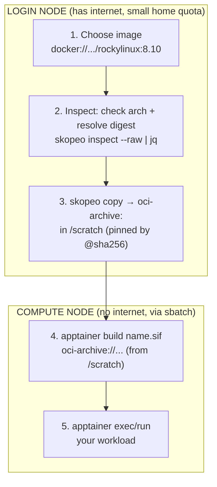

# Skopeo + Apptainer HPC Workflow

## Overview

This guide ties [[skopeo-beginner-guide|skopeo]] and [[isaaclab-metagrasp-apptainer-hpc-beginner-guide|Apptainer]] into one repeatable pipeline: **choose an image → check its architecture and digest → copy it to an `oci-archive:` in `/scratch` → `apptainer build` a `.sif` → run it in an `sbatch` job.** It is the workflow you actually use week to week on a cluster, distilled into something you can script and forget.

The constraints that shape every step are HPC-specific: on ASU's **Sol** (Slurm, Rocky Linux 8, `amd64`) you have no Docker daemon, no root, a small home quota, and compute nodes that often cannot reach the internet. So the division of labor is fixed: **registry work happens on a login node**, large files live in **`/scratch`**, and **compute nodes only build and run** from files already on disk. Get that separation right and everything else is detail.

**What you will learn:**

- The five-stage pipeline and *why* each stage sits where it does
- How to pin by digest so a job submitted today reproduces exactly next year
- A reusable `pull-to-sif.sh IMAGE OUTPUT.sif` script that fails cleanly on "image not found"
- A complete `sbatch` job using Sol defaults (`--partition=public --qos=public`)
- Where this breaks and how to recover

## Prerequisites

- **Skopeo installed** in `~/.local/bin` with a `policy.json` in place — see [[skopeo-beginner-guide|the beginner's guide]] if either is missing.
- **Apptainer available** on both login and compute nodes (`apptainer --version`, possibly after `module load apptainer`).
- **A `/scratch/$USER` directory** you can write to, with room for image tarballs and `.sif` files (these are gigabytes, not megabytes).
- **Access to a login node with outbound internet** and compute nodes reachable via Slurm.
- Comfort submitting jobs with `sbatch` / `squeue`; if your cluster uses [[hyperqueue-basics|HyperQueue]] or [[flux-basics|Flux]] on top of Slurm, the build stage is identical and only the submission wrapper changes.
- Optional but recommended: the reproducibility mindset from [[skopeo-deep-dive|the deep-dive]] — pin inputs, capture digests.

## Key Concepts

### The five stages and where each runs



The hard rule: anything that touches the network (stages 1–3) must run where the network exists — the login node. Anything compute-heavy (stages 4–5) runs under the scheduler. `/scratch` is the handoff point between the two worlds because it is visible from both and large enough to hold the artifacts.

### Why `/scratch`, not `$HOME`

Home directories on HPC are small and often backed up (so big churny files are unwelcome). `/scratch` is large, fast, and purpose-built for exactly these multi-gigabyte intermediates. Point skopeo's `--tmpdir`, the `oci-archive:` destination, and the `.sif` output all at `/scratch/$USER/`. Filling `$HOME` with image blobs is the single most common way this workflow goes wrong — see [[skopeo-beginner-guide|the beginner guide's]] troubleshooting.

### Why pin by digest

A tag like `8.10` can be repushed; a digest `@sha256:…` cannot change. Pinning by digest means the `.sif` you build in a job six months from now is bit-for-bit the image you validated today. This is the container analogue of lockfiles in [[uv-deep-dive|uv]] or [[pixi-deep-dive|Pixi]].

## Step-by-Step Instructions

### Stage 1 — Choose an image (login node)

Pick a fully-qualified reference. For a Rocky 8 base matching the cluster OS:

```bash
IMG=docker://docker.io/library/rockylinux:8.10
```

### Stage 2 — Check architecture and resolve the digest (login node)

Confirm it ships `amd64` and capture the immutable digest:

```bash
# Is amd64 present? (works whether single- or multi-arch)
skopeo inspect --override-arch amd64 --format '{{.Architecture}}/{{.Os}}' "$IMG"
```

```text
amd64/linux
```

```bash
# Resolve the tag to a digest and pin to it
DIGEST=$(skopeo inspect --override-arch amd64 --format '{{.Digest}}' "$IMG")
PINNED="docker://docker.io/library/rockylinux@${DIGEST}"
echo "$PINNED"
```

```text
docker://docker.io/library/rockylinux@sha256:d7d4…e3f1
```

### Stage 3 — Copy to an `oci-archive:` in `/scratch` (login node)

```bash
mkdir -p /scratch/$USER/images /scratch/$USER/tmp
skopeo copy --retry-times 3 --tmpdir /scratch/$USER/tmp \
  --digestfile /scratch/$USER/images/rocky810.digest \
  "$PINNED" oci-archive:/scratch/$USER/images/rocky810.tar:8.10
```

```text
Getting image source signatures
Copying blob 7a1c0b3f8e2d done
Copying config 1f2e3d4c5b done
Writing manifest to image destination
```

### Stage 4 — Build the `.sif` (compute node, via sbatch)

Apptainer builds are CPU- and I/O-heavy, so run them under the scheduler rather than on the shared login node. (Small images build fine on a login node too, but keep the habit.) The build reads only from `/scratch` — no network needed:

```bash
apptainer build /scratch/$USER/images/rocky810.sif \
  oci-archive:///scratch/$USER/images/rocky810.tar
```

```text
INFO:    Starting build...
INFO:    Creating SIF file...
INFO:    Build complete: /scratch/$USER/images/rocky810.sif
```

### Stage 5 — Run your workload (compute node, via sbatch)

```bash
apptainer exec /scratch/$USER/images/rocky810.sif cat /etc/os-release | head -1
```

```text
NAME="Rocky Linux"
```

## Practical Examples

### The reusable script: `pull-to-sif.sh`

Drop this in `~/.local/bin`, `chmod +x` it, and you have one command that does stages 1–4 with digest pinning and clean error handling. It leans on skopeo's exit code 2 ("image not found") to fail loudly and specifically.

```bash
#!/usr/bin/env bash
# pull-to-sif.sh IMAGE OUTPUT.sif [ARCH]
# Pin IMAGE by digest, copy to an oci-archive in /scratch, build OUTPUT.sif.
# Exit codes: 0 ok | 2 image not found | 1 any other error.
set -euo pipefail

IMAGE="${1:?usage: pull-to-sif.sh IMAGE OUTPUT.sif [ARCH]}"
OUT="${2:?usage: pull-to-sif.sh IMAGE OUTPUT.sif [ARCH]}"
ARCH="${3:-amd64}"

SCRATCH="/scratch/${USER}"
WORK="${SCRATCH}/images"
TMP="${SCRATCH}/tmp"
mkdir -p "$WORK" "$TMP"

# Normalize: ensure a docker:// prefix
case "$IMAGE" in
  docker://*) REF="$IMAGE" ;;
  *)          REF="docker://$IMAGE" ;;
esac

echo ">> Inspecting $REF ($ARCH)"
if ! DIGEST=$(skopeo inspect --override-arch "$ARCH" --format '{{.Digest}}' "$REF" 2>/dev/null); then
  rc=$?
  if [ "$rc" -eq 2 ]; then
    echo "!! Image not found: $REF" >&2
    exit 2
  fi
  echo "!! Inspect failed (rc=$rc): $REF" >&2
  exit 1
fi
echo ">> Digest: $DIGEST"

# Pin to the digest on the same repository path
REPO="${REF%%:*}"            # strip any :tag
REPO="${REPO%@*}"            # strip any @digest
PINNED="${REPO}@${DIGEST}"

TARBALL="${WORK}/$(basename "${OUT%.sif}").tar"
echo ">> Copying to oci-archive: $TARBALL"
skopeo copy --retry-times 3 --tmpdir "$TMP" \
  --digestfile "${TARBALL}.digest" \
  "$PINNED" "oci-archive:${TARBALL}"

echo ">> Building $OUT"
apptainer build "$OUT" "oci-archive://${TARBALL}"

echo ">> Done: $OUT (pinned $DIGEST)"
```

Usage:

```bash
pull-to-sif.sh docker.io/library/rockylinux:8.10 /scratch/$USER/images/rocky810.sif
```

```text
>> Inspecting docker://docker.io/library/rockylinux:8.10 (amd64)
>> Digest: sha256:d7d4…e3f1
>> Copying to oci-archive: /scratch/acchapm1/images/rocky810.tar
>> Building /scratch/acchapm1/images/rocky810.sif
>> Done: /scratch/acchapm1/images/rocky810.sif (pinned sha256:d7d4…e3f1)
```

Test the failure path:

```bash
pull-to-sif.sh docker.io/library/rockylinux:does-not-exist /scratch/$USER/x.sif
echo "exit: $?"
```

```text
>> Inspecting docker://docker.io/library/rockylinux:does-not-exist (amd64)
!! Image not found: docker://docker.io/library/rockylinux:does-not-exist
exit: 2
```

### Complete `sbatch` job (Sol defaults)

Because compute nodes have no internet, this job assumes the tarball is **already in `/scratch`** (run the login-node `skopeo copy`, or `pull-to-sif.sh` up to the build, beforehand). It builds if needed, then runs:

```bash
#!/bin/bash
#SBATCH --job-name=skopeo-apptainer
#SBATCH --partition=public
#SBATCH --qos=public
#SBATCH --nodes=1
#SBATCH --ntasks=1
#SBATCH --cpus-per-task=4
#SBATCH --mem=8G
#SBATCH --time=00:30:00
#SBATCH --output=%x-%j.out

set -euo pipefail
module load apptainer 2>/dev/null || true

SIF=/scratch/$USER/images/rocky810.sif
TARBALL=/scratch/$USER/images/rocky810.tar

# Build the .sif on the compute node if it is not already present
if [[ ! -f "$SIF" ]]; then
  echo "Building $SIF from $TARBALL"
  apptainer build "$SIF" "oci-archive://${TARBALL}"
fi

echo "=== image ==="
apptainer exec "$SIF" cat /etc/os-release | head -2

echo "=== workload ==="
apptainer exec "$SIF" bash -lc 'echo "Running on $(hostname) as $(id -un)"; python3 --version || echo "no python in base image"'
```

Submit and watch it:

```bash
sbatch run-rocky.sbatch
```

```text
Submitted batch job 1234567
```

```bash
squeue -u $USER
```

```text
   JOBID PARTITION     NAME     USER ST  TIME  NODES NODELIST(REASON)
 1234567    public skopeo-a acchapm1  R  0:03      1 cg1-5
```

### Pre-staging many images for offline compute (login node)

If a campaign needs several base images, mirror them once with `skopeo sync` (see [[skopeo-deep-dive|the deep-dive]]) so every subsequent job builds from `/scratch` with zero network:

```bash
cat > base-images.yaml <<'EOF'
docker.io:
  images:
    library/rockylinux: ["8.10"]
    library/python: ["3.12-slim"]
EOF
skopeo sync --src yaml --dest dir --scoped --keep-going \
  base-images.yaml /scratch/$USER/mirror
```

## Hands-On Exercises

1. **Run the pipeline by hand.** Do all five stages manually for `rockylinux:8.10`, writing everything to `/scratch`. Confirm the `.sif` runs with `apptainer exec … cat /etc/os-release`.

2. **Install and use `pull-to-sif.sh`.** Save the script, make it executable, and build a `python:3.12-slim` image with it. Then feed it a nonexistent tag and confirm it exits with code 2 and a clear message.

3. **Submit the job.** Pre-stage the tarball on the login node, submit the `sbatch` script, and read the `%x-%j.out` log. Confirm the job ran on a compute node (check the `hostname` line).

4. **Prove reproducibility.** Capture the digest from `pull-to-sif.sh`, rebuild from the digest-pinned reference a day later, and confirm `*.tar.digest` is unchanged.

5. **Offline build.** Mirror a base image to `/scratch` with `skopeo sync`, then build a `.sif` from the `dir:` layout *without* any `docker://` reference — simulating a compute node with no internet.

6. **Quota check.** Before and after a full run, compare `du -sh ~` and `du -sh /scratch/$USER`. Verify the gigabytes landed in `/scratch`, not home.

## Troubleshooting

**`apptainer build` fails with a network/DNS error on a compute node.** The build is trying to reach a registry. You passed a `docker://` reference instead of building from the pre-staged `oci-archive:`/`dir:` in `/scratch`. Do the `skopeo copy` on the login node first; build only from local files.

**`FATAL: while extracting … no space left on device` during build.** Apptainer's build cache or tmp filled `$HOME`. Set `export APPTAINER_TMPDIR=/scratch/$USER/tmp` and `export APPTAINER_CACHEDIR=/scratch/$USER/apptainer-cache` before building.

**`pull-to-sif.sh` exits 2.** The image/tag genuinely does not exist. Verify with `skopeo list-tags docker://…`. This is the script working as designed — exit 2 is "image not found."

**Job pends forever in `squeue`.** Wrong partition/QOS or resource request. On Sol, `--partition=public --qos=public` is the general-access combo; check `sinfo` and your allocation. This is scheduler config, not a skopeo/Apptainer problem.

**`oci-archive://` vs `oci-archive:` confusion.** `skopeo copy` writes to `oci-archive:PATH:TAG` (single colon). `apptainer build` reads from `oci-archive://PATH` (double slash). Mixing them up yields "unsupported transport" or "file not found" errors.

**Digest changed between pull and build.** If you pinned by tag rather than digest, the upstream tag moved. Always resolve to `@sha256:…` in stage 2 and pass the pinned reference forward — exactly what `pull-to-sif.sh` does.

**Rate-limited on the login-node pull.** Anonymous Docker Hub limit. `skopeo login docker.io` with a free account, or pre-mirror once with `skopeo sync` and reuse.

## References

- Apptainer build from OCI sources: https://apptainer.org/docs/user/main/build_a_container.html
- Apptainer environment variables (`APPTAINER_TMPDIR`, `APPTAINER_CACHEDIR`): https://apptainer.org/docs/user/main/environment_and_metadata.html
- Skopeo man pages: https://github.com/containers/skopeo/tree/main/docs
- Slurm `sbatch` reference: https://slurm.schedmd.com/sbatch.html
- ASU Sol / Research Computing docs (partitions, QOS): https://links.asu.edu/sol-docs

## Related Tutorials

- [[skopeo-beginner-guide|Skopeo Beginner's Guide]] — install, transports, inspect, and the first copy to `oci-archive:`
- [[skopeo-deep-dive|Skopeo Deep Dive]] — digests, `sync` for pre-staging fleets, config, and scripting internals
- [[isaaclab-metagrasp-apptainer-hpc-beginner-guide|IsaacLab + Apptainer HPC Guide]] — Apptainer fundamentals: building and running `.sif` images on Slurm
- [[isaaclab-metagrasp-apptainer-hpc-deep-dive|IsaacLab + Apptainer HPC Deep Dive]] — GPU, binds, and production Apptainer/Slurm patterns
- [[docker-bake-beginner-guide|Docker Bake Beginner Guide]] — building the multi-platform images you later transfer with skopeo
- [[apple-container-deep-dive|Apple Container Deep Dive]] — the local-authoring → Apptainer → cluster pipeline from the Mac side
- [[hyperqueue-basics|HyperQueue Basics]] — high-throughput dispatch of many containerized jobs
- [[flux-basics|Flux Basics]] — an alternative scheduler layer for containerized workloads
- [[parsl-beginner-guide|Parsl Beginner Guide]] — orchestrating Python workloads that run inside your `.sif`
- [[pixi-beginner-guide|Pixi Beginner Guide]] — reproducible environments that complement digest-pinned base images
- [[ssh-tutorial|SSH Tutorial]] — reaching login nodes and moving artifacts to `/scratch`

---

## Summary

The whole workflow is one sentence with a hard placement rule: **pin an image by digest and copy it to an `oci-archive:` in `/scratch` on a login node, then `apptainer build` and run it from `/scratch` on a compute node.** Network-touching stages (choose, inspect, copy) belong on the login node because compute nodes are often offline; heavy stages (build, run) belong under Slurm; and `/scratch` is the shared handoff because it is both visible everywhere and large enough for multi-gigabyte artifacts. Digest pinning makes the result reproducible; `pull-to-sif.sh` packages stages 1–4 with clean exit-code-2 handling; and the `sbatch` template with `--partition=public --qos=public` runs it on Sol. Keep `--tmpdir`, `APPTAINER_TMPDIR`, and `APPTAINER_CACHEDIR` all pointed at `/scratch`, and the most common failure — a full `$HOME` — never happens.

**Next step:** put `pull-to-sif.sh` in `~/.local/bin`, build one real base image you depend on, and pin its digest into a committed `base-images.yaml` so your whole group rebuilds the identical image on demand.
