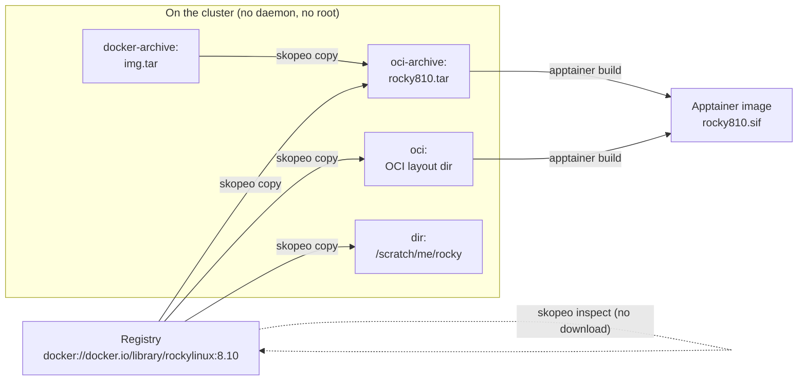

# Skopeo — Beginner's Guide

## Overview

If you work on an HPC cluster — a Slurm login node running Rocky Linux 8, no root, no Docker daemon — you have probably hit this wall: you want to run a container image, but every tool you know for pulling and inspecting images assumes a running daemon and administrative privileges you do not have. [[isaaclab-metagrasp-apptainer-hpc-beginner-guide|Apptainer]] can *run* images, but it needs a source to build from, and `apptainer pull docker://…` gives you almost no visibility or control over what you are downloading.

**Skopeo** fills exactly that gap. It is a small, daemonless, rootless command-line tool from the Podman / containers project for working with container images and registries. With a single static binary dropped into `~/.local/bin`, you can:

- **inspect** an image's metadata (digest, architecture, layers, labels) *without downloading it*,
- **list the tags** available in a repository,
- **copy** an image from a registry into an `oci-archive:` tarball that [[isaaclab-metagrasp-apptainer-hpc-beginner-guide|Apptainer]] can build a `.sif` from,
- and **log in** to private registries or Docker Hub to dodge rate limits.

No daemon. No root. No background service eating memory on a shared login node.

**What you will learn in this guide:**

- What skopeo is and why it exists
- How to install the static binary into `~/.local/bin` on a cluster and why you must create a `policy.json` before it will run
- The mental model of **transports** — the single idea that makes every skopeo command click
- How to inspect images and list tags
- How to copy an image into an `oci-archive:` and hand it to `apptainer build`
- How to log in to a private registry
- The handful of gotchas that trip up everyone the first week

This guide targets a real setup: ASU's **Sol** cluster (Slurm, Rocky Linux 8, `amd64`), where compute nodes may have no outbound internet, so all registry work happens on a login node. The commands are copy-pasteable with real image names; adapt paths to your own cluster.

## Prerequisites

Before you start you should have:

- **Command-line comfort.** You can `ssh` into a cluster, edit files, and read `man` pages. If `ssh` itself is new, see [[ssh-tutorial|the SSH tutorial]].
- **An HPC account with a writable `~/.local/bin`** (and ideally a `/scratch` space — skopeo writes large temporary files and your home quota is usually small).
- **`~/.local/bin` on your `PATH`.** Check with:

  ```bash
  echo "$PATH" | tr ':' '\n' | grep -q "$HOME/.local/bin" && echo "on PATH" || echo "add it"
  ```

  If it says `add it`, append this to `~/.bashrc` and re-login:

  ```bash
  echo 'export PATH="$HOME/.local/bin:$PATH"' >> ~/.bashrc
  ```

- **A way to get the binary onto the cluster.** You will either cross-compile it on your laptop (shown below) or copy a release/distro binary. A basic understanding of file ownership helps here; see [[linux-permissions-beginner-guide|Linux Permissions]] if `install -m755` is unfamiliar.
- **[[isaaclab-metagrasp-apptainer-hpc-beginner-guide|Apptainer]] available on the cluster** (`module load apptainer` or already on `PATH`) if you want to follow the final build step. Most HPC sites provide it.

You do **not** need Docker, Podman, or root for anything in this guide.

## Key Concepts

### Daemonless and rootless

Docker runs a privileged background daemon; every `docker` command talks to it. On a shared login node you cannot run that daemon and would not want to. Skopeo is just a binary that does one operation and exits — no daemon, no persistent state, nothing to leave running. That is the whole reason it belongs on HPC.

### Transports — the one idea to internalize

Every image skopeo touches is named by a **transport** prefix followed by a location. The transport tells skopeo *where the image lives and in what format*. Learn these six and you understand 90% of skopeo:

| Transport | Example | What it is |
|---|---|---|
| `docker://` | `docker://docker.io/library/rockylinux:8.10` | An image in a remote **registry** |
| `oci:` | `oci:rocky:8.10` | An **OCI layout** directory (a folder of blobs) |
| `oci-archive:` | `oci-archive:rocky810.tar:8.10` | An OCI layout packed into a **single tarball** — what Apptainer builds from |
| `docker-archive:` | `docker-archive:img.tar` | The tarball `docker save` produces |
| `dir:` | `dir:/scratch/me/rocky` | A plain **directory** dump of an image's blobs |
| `containers-storage:` | `containers-storage:rocky:8.10` | An image in local **Podman** storage |

Almost every skopeo command is "take an image from transport A, do something, optionally write it to transport B." `skopeo copy SOURCE DEST` is literally that. Once transports click, the tool stops feeling mysterious.



### Why a `policy.json` is required

Skopeo refuses to run *at all* until it finds a **signature trust policy** at `~/.config/containers/policy.json`. This file answers the question "which images am I allowed to accept?" It is a safety feature inherited from the containers library: the tool will not silently pull unsigned images unless you have explicitly said that is acceptable. For everyday HPC use you tell it "accept anything" — but you have to say so on purpose. We create this file during installation below.

### Fully-qualified image names

Skopeo (unlike Docker) does **not** assume `docker.io/library/` in front of a bare name. Write `docker://docker.io/library/rockylinux:8.10`, not `docker://rockylinux:8.10`. Being explicit avoids a whole category of confusing errors.

## Step-by-Step Instructions

### Step 1 — Get the binary onto the cluster

You have two realistic options.

**Option A — cross-compile on your laptop (recommended, fully static, no surprises).** If you have Go on a Mac or Linux box, build a static `linux/amd64` binary and copy it over. This is the approach used to produce the `skopeo 1.25.1` binary on Sol:

```bash
# On your laptop, inside a clone of github.com/containers/skopeo
CGO_ENABLED=0 GOOS=linux GOARCH=amd64 go build -trimpath -ldflags '-s -w' \
  -tags 'containers_image_openpgp exclude_graphdriver_btrfs' \
  -o bin/skopeo.linux.amd64 ./cmd/skopeo
```

What the flags mean, briefly: `CGO_ENABLED=0` makes it fully static (no glibc dependency to mismatch against the cluster); `GOOS/GOARCH` cross-target Linux amd64 even from an Apple Silicon Mac; `-tags containers_image_openpgp` swaps GPG for a pure-Go OpenPGP implementation so you need no C library; `exclude_graphdriver_btrfs` drops an unused storage driver. (The [[skopeo-deep-dive|deep-dive]] covers every build tag and what dropping cgo costs you.)

Then transfer and install:

```bash
# Stage through scratch, then install into ~/.local/bin on the cluster
rsync -av bin/skopeo.linux.amd64 sol:/scratch/$USER/transfer/skopeo/
ssh sol
install -m755 /scratch/$USER/transfer/skopeo/skopeo.linux.amd64 ~/.local/bin/skopeo
```

**Option B — use a packaged binary** if your site provides one (`module avail skopeo`, or `dnf download` on a machine where you *do* have packages, then copy the extracted binary). Static release binaries from the skopeo project also work if the glibc matches.

Verify:

```bash
skopeo --version
```

```text
skopeo version 1.25.1
```

### Step 2 — Create the trust policy

Skopeo will error until this exists. Create the minimal "accept anything" policy:

```bash
mkdir -p ~/.config/containers
cat > ~/.config/containers/policy.json <<'EOF'
{
    "default": [
        {
            "type": "insecureAcceptAnything"
        }
    ]
}
EOF
```

`insecureAcceptAnything` means "do not require signatures." That is normal and fine for pulling public base images on HPC. If your organization signs its images, the [[skopeo-deep-dive|deep-dive]] shows how to write a stricter policy that only accepts signed content.

### Step 3 — Inspect an image without downloading it

This is the single most useful first command. It fetches only the manifest and config — kilobytes, not gigabytes:

```bash
skopeo inspect docker://docker.io/library/rockylinux:8.10
```

```json
{
    "Name": "docker.io/library/rockylinux",
    "Digest": "sha256:d7d4...e3f1",
    "RepoTags": ["8", "8.10", "9", "9.3", "latest", "…"],
    "Architecture": "amd64",
    "Os": "linux",
    "Layers": ["sha256:7a1c…", "…"],
    "Env": ["PATH=/usr/local/sbin:…"]
}
```

Grab just the digest (useful for pinning a reproducible version later):

```bash
skopeo inspect --format '{{.Digest}}' docker://docker.io/library/rockylinux:8.10
```

```text
sha256:d7d4...e3f1
```

Check the config (entrypoint, env, user) with `--config`, or the raw manifest (to see if it is multi-arch) with `--raw`:

```bash
skopeo inspect --config docker://quay.io/libpod/alpine:latest | jq '.config.Env'
```

### Step 4 — List the tags in a repository

```bash
skopeo list-tags docker://docker.io/library/rockylinux | jq -r '.Tags[]' | head
```

```text
8
8.10
8.9
9
9.3
latest
…
```

### Step 5 — Copy an image to an `oci-archive:` for Apptainer

This is the payoff. Pull the registry image into a single tarball:

```bash
skopeo copy docker://docker.io/library/rockylinux:8.10 oci-archive:rocky810.tar:8.10
```

```text
Getting image source signatures
Copying blob 7a1c0b3f8e2d done
Copying config 1f2e3d4c5b done
Writing manifest to image destination
Storing signatures
```

Then let Apptainer build a runnable `.sif` from it:

```bash
apptainer build rocky810.sif oci-archive://rocky810.tar
```

```text
INFO:    Starting build...
INFO:    Creating SIF file...
INFO:    Build complete: rocky810.sif
```

Run it:

```bash
apptainer exec rocky810.sif cat /etc/os-release | head -1
```

```text
NAME="Rocky Linux"
```

You just went from a public registry to a runnable cluster image with no daemon and no root. For the full end-to-end job workflow — pinning by digest, building in `/scratch`, and running under `sbatch` — see [[skopeo-apptainer-hpc-workflow|the Skopeo + Apptainer HPC workflow]].

### Step 6 — Log in to a private registry (or beat Docker Hub rate limits)

Anonymous Docker Hub pulls are rate-limited. Logging in with a free account raises the limit:

```bash
skopeo login docker.io
```

```text
Username: yourname
Password:
Login Succeeded!
```

Credentials are written to `${XDG_RUNTIME_DIR}/containers/auth.json` (or `~/.config/containers/auth.json`). The same works for `quay.io`, GitHub Container Registry (`ghcr.io`), or a private site registry. Log out with `skopeo logout docker.io`.

## Practical Examples

**Pin a base image by digest** so your build is reproducible even if the tag moves:

```bash
DIGEST=$(skopeo inspect --format '{{.Digest}}' docker://docker.io/library/rockylinux:8.10)
skopeo copy "docker://docker.io/library/rockylinux@${DIGEST}" oci-archive:rocky-pinned.tar
```

**Check an image's architecture before wasting compute time** on the wrong one:

```bash
skopeo inspect --format '{{.Architecture}}/{{.Os}}' docker://docker.io/library/python:3.12-slim
```

```text
amd64/linux
```

**Copy to `/scratch` and keep home clean** (skopeo's temp files can be large):

```bash
skopeo copy --tmpdir /scratch/$USER/tmp \
  docker://quay.io/libpod/alpine:latest \
  oci-archive:/scratch/$USER/images/alpine.tar
```

**Inspect an image built for a different arch** (e.g. checking the amd64 variant of a multi-arch image from an Apple Silicon Mac — relevant if you also do [[docker-bake-beginner-guide|cross-platform builds with Docker Bake]]):

```bash
skopeo inspect --override-arch amd64 docker://docker.io/library/rockylinux:8.10 \
  | jq '.Architecture'
```

```text
"amd64"
```

## Hands-On Exercises

1. **Install and verify.** Get skopeo onto your cluster (or a local Linux box), create `policy.json`, and confirm `skopeo --version` works. Then deliberately rename `policy.json` and run `skopeo inspect` — read the error message so you recognize it later. Rename it back.

2. **Inspect three images.** Run `skopeo inspect` on `rockylinux:8.10`, `alpine:latest`, and `python:3.12-slim`. For each, record the digest and architecture using `--format`. Which ones are multi-arch? (Hint: compare `inspect` against `inspect --raw | jq '.manifests'`.)

3. **Registry → `.sif`.** Copy `docker://quay.io/libpod/alpine:latest` to an `oci-archive:`, then `apptainer build alpine.sif oci-archive://alpine.tar` and run `apptainer exec alpine.sif cat /etc/os-release`.

4. **Pin and rebuild.** Resolve `rockylinux:8.10` to a digest, copy the digest-pinned reference to a new tarball, and confirm the resulting `.sif` works. You now have a build that will produce the identical image months from now.

5. **Scratch discipline.** Redo exercise 3 but direct all output and temp files to `/scratch/$USER/`. Check your home directory quota before and after with `du -sh ~` to confirm nothing leaked into `$HOME`.

## Troubleshooting

**`skopeo: Error: open /…/policy.json: no such file or directory`**
You skipped Step 2. Skopeo will not run without a trust policy. Create `~/.config/containers/policy.json` as shown.

**`Error: reading manifest … in docker.io/library/…: manifest unknown`** *(exit code 2)*
The image or tag does not exist. Skopeo exits with **code 2** specifically for "image not found," versus **1** for any other error — handy in scripts (`if ! skopeo inspect …; then …`). Double-check the tag with `skopeo list-tags`.

**`toomanyrequests: You have reached your pull rate limit`**
You are pulling anonymously from Docker Hub. Run `skopeo login docker.io` with a free account, or mirror the image once to `/scratch` and reuse it.

**`Error: short-name resolution … "rockylinux"`**
You used a bare name. Fully-qualify it: `docker://docker.io/library/rockylinux:8.10`.

**`no space left on device` during copy**
Skopeo is filling your home quota with temporary blobs. Add `--tmpdir /scratch/$USER/tmp` and write the destination under `/scratch`, not `$HOME`.

**`containers-storage: … cannot re-exec in a user namespace`**
This static, no-cgo build cannot use the `containers-storage:` transport rootlessly. That is expected — use `oci:` or `oci-archive:` instead, which is what you want for Apptainer anyway.

**Compute node can't reach the registry.**
Many clusters block outbound internet on compute nodes. Do all `skopeo copy` / `login` work on a **login node**, write the tarball to `/scratch`, and only `apptainer build` / run on the compute node.

## References

- Skopeo project (source, README): https://github.com/containers/skopeo
- Skopeo man pages: https://github.com/containers/skopeo/tree/main/docs
- Apptainer documentation: https://apptainer.org/docs/
- containers trust policy (`policy.json`) format: https://github.com/containers/image/blob/main/docs/containers-policy.json.5.md
- `containers-registries.conf` reference: https://github.com/containers/image/blob/main/docs/containers-registries.conf.5.md

## Related Tutorials

- [[skopeo-deep-dive|Skopeo Deep Dive]] — architecture, multi-arch, sync/mirror, signing, config files, and scripting patterns
- [[skopeo-apptainer-hpc-workflow|Skopeo + Apptainer HPC Workflow]] — the full registry → `.sif` → `sbatch` pipeline with a reusable script
- [[isaaclab-metagrasp-apptainer-hpc-beginner-guide|IsaacLab + Apptainer HPC Guide]] — building and running Apptainer images on a Slurm cluster, the runtime target for skopeo's output
- [[docker-bake-beginner-guide|Docker Bake Beginner Guide]] — declarative multi-platform image builds; skopeo inspects and transfers what Bake produces
- [[apple-container-beginner-guide|Apple Container Beginner's Guide]] — authoring OCI images on an Apple Silicon Mac before shipping them to a cluster
- [[docker-test-container-beginner-guide|Docker Test Container Beginner Guide]] — container and image fundamentals that make transports easier to reason about
- [[linux-permissions-beginner-guide|Linux Permissions Beginner Guide]] — ownership and `install -m755`, used when placing the binary
- [[ssh-tutorial|SSH Tutorial]] — reaching the login node and `rsync`-ing the binary across
- [[hyperqueue-basics|HyperQueue Basics]] — dispatching many containerized jobs once your `.sif` is built
- [[pixi-beginner-guide|Pixi Beginner Guide]] — reproducible environments that pair well with pinned base images

---

## Summary

**Key takeaways:**

1. **Skopeo is daemonless and rootless** — a single static binary in `~/.local/bin`, which is exactly what an HPC login node allows and Docker does not.

2. **Transports are the whole model.** `docker://` for registries, `oci-archive:` for the tarball Apptainer builds from, `dir:`/`oci:` for on-disk layouts. Every command is "from transport A to transport B."

3. **You must create `~/.config/containers/policy.json` first.** `insecureAcceptAnything` is the normal starting point; skopeo refuses to run without a policy.

4. **`inspect` before you pull.** Check digest and architecture for kilobytes instead of downloading gigabytes of the wrong image.

5. **The core HPC move:** `skopeo copy docker://… oci-archive:img.tar` then `apptainer build img.sif oci-archive://img.tar`.

6. **Mind the footguns:** fully-qualify names, log in to dodge Docker Hub limits, use `/scratch` and `--tmpdir` to protect your home quota, remember exit code 2 = not found, and do registry work on a login node.

**Next step:** pin a base image by digest and build it into a `.sif`, then read [[skopeo-apptainer-hpc-workflow|the Skopeo + Apptainer HPC workflow]] to wrap the whole thing in a reusable script and an `sbatch` job.
